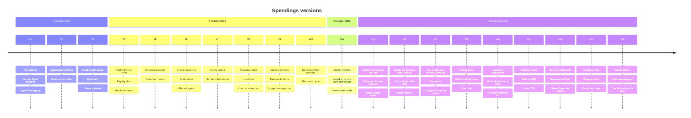

# Changelog

How Spendings has changed, version by version, newest first.

Version numbers follow the app's cache version (`VERSION` in `docs/sw.js`), so the number here is the one a phone is running. A version gets a new entry whenever that number goes up. Versions v4 to v8 reached the live app together through [PR #1](https://github.com/Bu9abi-dev/spendings/pull/1), merged on 7 October 2026. Changes to `apps-script/Code.gs` only reach the sheet after the code is pasted into Apps Script and a new version of the existing deployment is published.

## Timeline

---

## v20: Subscriptions
**30 October 2026** · no sheet update needed

- Insights has a **Subscriptions** card: payments that repeat every week, month or year (Netflix, Spotify, the gym…), with what they cost per month in total and when each is next expected.
- A subscription that **started charging this month** is flagged, so a free trial that turned into a payment doesn't slip by. "Not a subscription" hides one that isn't.
- Weekly coffee or grocery runs aren't counted as subscriptions.
- Home shows **one quiet line at a time**: a category over its limit first, then a new subscription, one due in the next 3 days, then a category close to its limit.
- The monthly report shows what subscriptions cost per month.

---

## v19: Category budgets
**30 October 2026** · no sheet update needed

- **Settings → Category limits**: set a monthly limit for any spending category, including your own. Only the categories with a limit are listed; "Add a limit" adds another.
- Insights has a **Category budgets** card: a bar per limit with what's left, turning amber near the limit and red over it.
- Home shows one quiet line when a category passes 80% or goes over this cycle. Tap it to see the details.
- Refunds aren't taken off a limit; they count as money in, the same as everywhere else in the app.
- The monthly report lists your limits too.

---

## v18: Your own categories
**30 October 2026** · sheet update optional

- **Settings → Categories**: add your own categories (Coffee, Car, University…) with an icon, rename any category, or hide ones you don't use. Works for spending and money-in.
- Renaming only changes what the app shows. Your sheet keeps the original name, so old entries, the Apple Pay Shortcut and remembered shops keep working.
- Hidden categories leave the pickers but stay on old entries, in Insights, Activity filters and the monthly report. A category of your own can be deleted while no entry uses it.
- Smart suggestions learn your own categories too, and never suggest a hidden one.
- The sheet part (optional) lets the Shortcut send your own categories, and the sheet's summary tab lists them. Until the new `apps-script/Code.gs` is deployed, a payment sent with a custom category lands in Needs review, as before.

---

## v17: Monthly report
**30 October 2026** · no sheet update needed

- Insights has a **Monthly report** for any pay cycle: money in, spent, refunds and what you kept, where it went by category, your top shops, the allowance, and budgets once you set them. Every list adds up to the totals at the top.
- **Save as PDF** prints the page. From the home-screen app it opens the report in Safari with a hint: Share → Print, then pinch out to save the PDF.
- **Share report** sends the page, and **Export CSV** gives you just that cycle's entries.

---

## v16: Smarter categories
**30 October 2026** · no sheet update needed

- **Needs review suggests a category** for each payment, learned from how you filed the same shop before. Bank-style names like "CARREFOUR ABU DHABI AE" are matched to "Carrefour".
- When the app is sure, one tap files every payment from that shop, and "File N with their suggestions" files all the sure ones at once. When it only has a guess ("Maybe like…"), you pick, so nothing gets filed wrongly behind your back.
- Similar names that are different shops stay apart: Noon and Noon Food, Careem and Careem Food, Uber and Uber Eats.
- The add sheet picks the category for a shop it knows well, and only suggests one when it's unsure.

---

## v15: Activity filters and bulk edit
**30 October 2026** · no sheet update needed

- Activity has **filters**: account, category, a cycle or your own dates, and an amount range. The total of what's showing sits on top, with spending, refunds and money in shown separately.
- **Select** lets you pick several entries and change their category or delete them in one go. Before deleting, it lists what will go. One Undo puts them all back.
- Selecting never includes entries you can't see on screen. If more entries match than the list shows, it says so.

---

## v14: Spending charts
**30 October 2026** · no sheet update needed

- Insights has a **Day by day** chart of the cycle's spending, with a weekly view. Press and slide along it to see any day. Moving money between your accounts is left out, because it isn't spending.
- **Top places** lists where your money went most this cycle and how many payments each got.
- **Categories over six cycles** shows each category's last six cycles side by side, with your usual amount, so you can see what's creeping up.

---

## v13: Cleaner Shortcut tests and faster screens
**30 October 2026** · sheet update needed

- Tapping ▶ on the Apple Pay Shortcut to test it now shows "Connected ✓" and logs nothing. Before, it added an AED 0 entry to Needs review that you had to delete.
- If your iPhone sends amounts in Arabic digits (٤٢٫٥٠), the sheet now reads them as 42.50 instead of 0.
- A real payment whose amount can't be read is still kept in Needs review, so nothing is ever dropped.
- Every screen works out dates faster. With a few thousand entries, Insights opens about three times quicker.
- The sheet part needs the new `apps-script/Code.gs` pasted into Apps Script and a new version of the deployment published. If you haven't done v12's update yet, this one covers both.

---

## v12: Groundwork for new features
**30 October 2026** · sheet update needed

- The rows under "Where your money is" are whole numbers that now always add up to the total shown. Before, each row was rounded on its own and could be a dirham or two off.
- If the allowance card and the main account are set to the same account, Safe to spend is counted once, and it can't be more than that account's free money.
- The sheet gets a new **Extras** tab. Upcoming features like category budgets and savings goals save their settings there, one row each, so the Ledger is never touched.
- Until the new script is in Apps Script, those settings stay on your phone, and Settings says so. They're saved to the sheet straight after the update.
- Behind the scenes: tests that only passed on some dates now pass on any date, and the code is split into smaller files so several features can be built at once.
- The sheet part needs the new `apps-script/Code.gs` pasted into Apps Script and a new version of the deployment published. The Apple Pay and bank Shortcuts don't change.

---

## v11: Calmer syncing
**8 October 2026** · no sheet update needed

- The app now waits up to 45 seconds for the sheet instead of 20, so a slow Apps Script reply no longer counts as a failure.
- A timeout or a dropped connection no longer shows a red error. The badge quietly says how many changes are waiting, and the app tries again when you come back to it, when the phone reconnects, and every 15 seconds until it goes through. Real problems, like a wrong app key, still show as an error.
- The "Syncing" spinner only appears if a sync takes more than 3 seconds, so quick saves don't make the badge flicker.
- After sending your changes, the app skips re-reading the whole sheet if it read it less than 30 seconds ago, and just marks those changes as synced. Saves go through faster and use fewer Apps Script calls.

---

## v10: Dismiss payday prompts
**7 October 2026** · no sheet update needed

- Every payday prompt now has a ✕ to dismiss it: "Salary due", "It landed", "Move now", "Allowance not moved yet" and a responsibility still to pay. Use it when the money already landed, moved or got paid before you started tracking.
- A dismissed prompt stays hidden until the cycle ends, and the row says when it's back ("done, back on 27 Oct"). On the next payday it comes back as usual.
- Dismissing logs nothing and doesn't change any balance. The item just stops counting as still to come, so ADIB's "Still to move" and "Responsibilities" drop.
- Dismissing the allowance move keeps Safe to spend honest: it can't be more than ADCB holds. Whatever of the allowance isn't in ADCB counts as spent before you started tracking, and the allowance card says so.
- The ✕ has a big tap area with a gap between it and "tap when it lands", so a near miss can't log the money twice.
- The toast's Undo brings back only that prompt. "Bring back" on the row and the main undo button work too.
- Dismissals are kept on your phone, not in the sheet.

---

## v9: Online payments from bank notifications
**7 October 2026** · sheet update needed

- Online and in-app payments are logged from your bank app's notification, through a new Shortcuts automation. Setup is in SETUP.md, section 3b.
- Only card payments are logged. Salary, transfers, refunds, ATM withdrawals and OTP messages are ignored.
- Topping up one of your own accounts with a card, like BOTIM from the ADCB card, is logged as a move between accounts, not spending.
- A tap at a card machine sends both an Apple Pay trigger and a bank notification. The sheet sees they're the same payment and logs it once.
- The sheet part needs the new `apps-script/Code.gs` pasted into Apps Script and a new version of the deployment published.

---

## v8: Undo fixes and the allowance rules
**7 October 2026** · sheet update needed

### Allowance rules
- Moving money between accounts counts as reallocating, not spending. Safe to spend no longer drops when money moves on from ADCB.
- "Allowance not moved yet" only shows for the real payday move.
- A refund into ADCB gives the allowance back exactly. Anything beyond what was spent goes to the buffer.
- A top-up from ADIB to ADCB beyond the planned move adds to Safe to spend and doesn't shrink "Move now". If it's unspent at payday, it carries into the new cycle on top of the allowance.
- Leftover allowance stays in ADCB as a buffer, and Safe to spend still resets each cycle.
- The sheet follows the same rules: the Apple Pay "left of your allowance" message, the cycle tabs and the Overview all add refunds back.

### Undo
- Leaving or entering demo mode clears undo, so a demo entry can't end up in the real sheet.
- Undoing an edit puts the entry back exactly, including its price and Needs review flag, and the sheet keeps the old price.
- Editing only the note of a USD entry keeps its price.
- Undoing a payday plan change restores the allowance amount too.

### Fixes
- Changing the cycle start day re-tags the sheet's Cycle column, and the app works out the cycle from the date on every sync.
- "Where your money is" gives archived accounts a row, so the rows always add up to the total.
- Account keys scroll when dragged to the edge, and the Activity filter chips no longer block page scrolling.
- Automatic checks for the maths and undo now run against the app's real code.

---

## v7: Safe to spend and numbers that add up
**7 October 2026**

Changes picked from a review of the app by an advisory council (reports in `council/`).

- Home shows Safe to spend (the ADCB allowance left this cycle) with a pace line: on track, or over pace per day.
- The All tab still leads with total money; Safe to spend sits on the line below it.
- "Where your money is" breaks the total into parts that add up exactly.
- The allowance capsule on All is always a percentage. This fixes a bug where 86% showed as "AED 88".
- Nafis due and "allowance not moved" can be tapped straight from the top of Home.
- The money flow drawing moved to the ADIB view.
- The allowance is set in one place (the payday plan), and the Budget row links there.
- Removing an account also removes payday plan rows that pointed at it, and it can be undone.
- Adding entries is smarter: transfers default to ADIB → ADCB, income to ADIB, a known merchant brings back its card, big amounts need a second tap, an unready Save points at what's missing, and there's an overdraft warning.
- Softer fade under the floating tab bar, a hero number that shrinks to fit, readable account badges and clearer wording.
- Fix: switching to the iPhone keyboard could take focus away from a field.

---

## v6: Undo everywhere, reset and an iPhone keypad
**7 October 2026** · sheet update needed

- Every account view has a liquid "left this cycle" capsule. On All it's a percentage of what you had this cycle.
- Undo for every change: a round Undo button by the title, Undo in every message at the bottom, and Cmd/Ctrl+Z.
- Settings → Reset sheet, confirmed by pressing and holding. The sheet keeps a hidden backup of the Ledger first.
- The amount keypad was rebuilt to look and feel like the iPhone keyboard, in light and dark.
- Keyboard friendly: switch to the iPhone keyboard, Return moves amount → place → note → save, sheets stay above the keyboard, and there are shortcuts (N, 1 to 4, arrows, /).

---

## v5: Your own accounts and smoother motion
**7 October 2026** · sheet update needed

- Add, rename, recolour or remove accounts, and set each one's Apple Wallet name. A rename carries through every past entry, the plan and settings. Removing an account first asks where its remaining money should go.
- The sheet has a new Accounts tab, and Apple Pay card matching uses it.
- A "+" key on Home adds an account, and the keys row scrolls when there are many.
- Digits roll like an odometer, the account pill follows your finger while dragging, new entries slide into lists, and payday ticks spring in.
- The large title hands over smoothly to the glass bar as you scroll.

---

## v4: Spendings v2, total money and the payday plan
**7 October 2026** · sheet update needed

A redesign of Home around all your money.

- Home leads with all your money as one number, over a bar whose segments are the real account balances. Tap or drag along it to focus one account.
- ADIB view splits into responsibilities, money still to move and emergency money. ADCB view keeps the allowance capsule.
- Payday plan (Salary, Nafis, the allowance move and responsibilities) with one-tap "It landed" and "Move now". The sheet gets a Plan tab.
- Match with bank: type what the bank app shows and the app books the difference as an Adjustment, so balances never drift.
- A to-scale drawing of how ADIB's money moved this cycle.
- Dirham sign and more realistic demo data.
- Apple Pay messages show the account balance once that account has been matched with the bank.

---

## v3: Polish for small phones
**5 October 2026**

- The add sheet fits iPhone SE and mini, with categories staying above the keypad.
- Large amounts scale down to fit.
- Quick add row for frequent purchases, and "Log this again" when editing an entry.
- Swipe left on an entry to delete it, with undo.
- Softer status colours and clearer fields in dark mode.
- Fix: a crash when an entry arrived without a date.

---

## v2: Appearance settings
**5 October 2026**

- A softer default accent colour (muted slate blue) that's gentler on black.
- Settings → Appearance: Automatic, Light or Dark theme, 8 accent colours, and a colour per card. Every option is contrast-checked in both themes.

---

## v1: First release
**5 October 2026** · first sheet setup

- An iPhone web app in Apple's design language: Liquid Glass bars, a liquid allowance capsule, spring motion, and Home, Activity, Insights and Settings tabs.
- Add and edit entries with a keypad, a Needs review inbox, offline queue that syncs later, optional Face ID lock, CSV export and demo data.
- Google Sheet backend: Ledger, Overview, a tab per pay cycle (27th to 26th) with charts, Settings and Merchants.
- Apple Pay logging from an iOS Shortcut, with card mapping, USD conversion at the 3.6725 peg, duplicate protection and merchant memory.
- Hosted on Vercel, with setup steps in [SETUP.md](SETUP.md).

Before v1, the plan was reviewed by an advisory council (`council/`).
